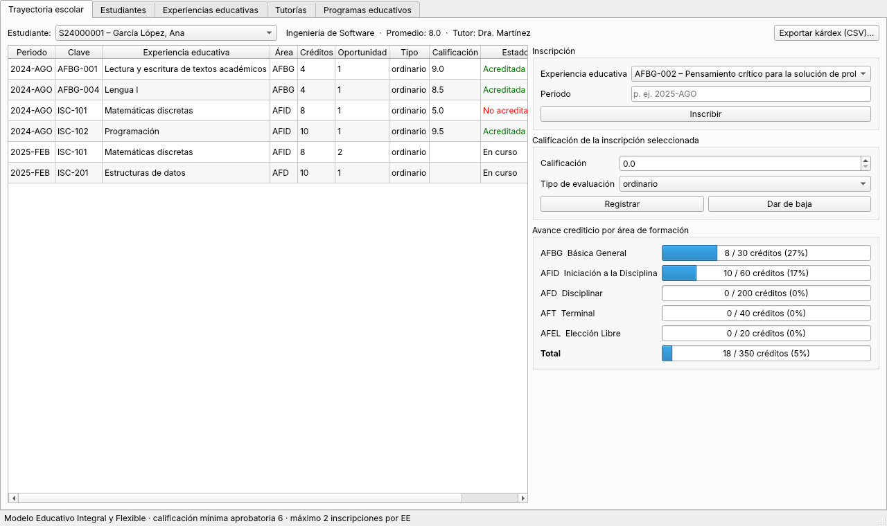

# Plataforma de escritorio MEIF

Aplicación de escritorio para gestionar la trayectoria escolar bajo el
**Modelo Educativo Integral y Flexible (MEIF)**: programas educativos,
estudiantes, experiencias educativas (EE), inscripciones, calificaciones,
avance crediticio por área de formación y tutorías.



Hecha con Python + PySide6 (Qt) y una base de datos SQLite local.

## Funciones

| Pestaña | Qué hace |
|---|---|
| **Trayectoria escolar** | Inscribe EE, registra calificaciones (ordinario, extraordinario, título de suficiencia), da de baja, muestra el avance por área y el promedio, y exporta el kárdex a CSV. |
| **Estudiantes** | Alta, edición, búsqueda y baja de estudiantes, con programa y tutor. |
| **Experiencias educativas** | Catálogo de EE por área (AFBG, AFID, AFD, AFT, AFEL), créditos, horas y prerrequisitos. |
| **Tutorías** | Bitácora de sesiones de tutoría por estudiante. |
| **Programas educativos** | Créditos requeridos por área y carga máxima por periodo. |

### Reglas académicas que valida

- Calificación mínima aprobatoria: **6**.
- Máximo **2 inscripciones** por EE; no se reinscribe una EE acreditada ni una en curso.
- Los **prerrequisitos** deben estar acreditados (y no se permiten ciclos).
- No se excede la **carga máxima de créditos** del periodo.
- Las EE disciplinares solo se inscriben en su programa; las transversales (AFBG/AFEL) en cualquiera.
- El promedio toma la última calificación de cada EE.

Los valores están en `meif/db.py` (`CALIFICACION_MINIMA`, `MAX_INSCRIPCIONES_POR_EE`)
por si tu institución usa otros.

## Instalación y uso

```bash
pip install -r requirements.txt
python -m meif --demo        # primera vez, con datos de ejemplo
python -m meif               # uso normal (~/.meif/meif.db)
python -m meif --db otra.db  # otra base de datos
```

### Crear un ejecutable (.exe / app)

```bash
pip install pyinstaller
pyinstaller --name MEIF --windowed --onefile meif/__main__.py
```

## Pruebas

```bash
python -m unittest -v
```
