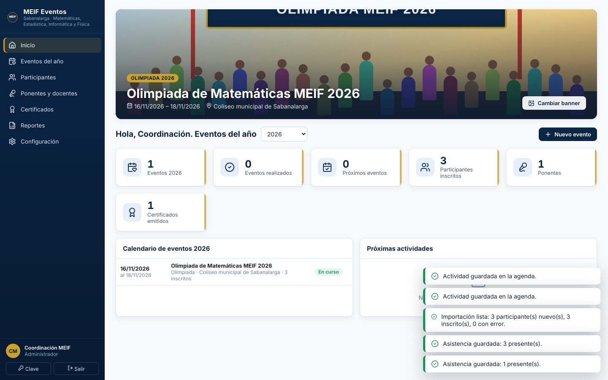
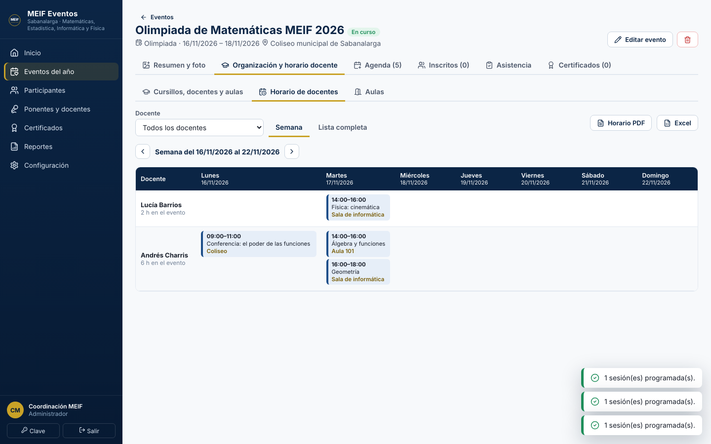

# MEIF Eventos

Plataforma de escritorio para **organizar los eventos del año de MEIF – Sabanalarga**
(Matemáticas, Estadística, Informática y Física): olimpiadas, cursillos, preparación
Saber 11°, ferias de la ciencia, seminarios y talleres.



## Qué incluye

| Módulo | Para qué sirve |
|---|---|
| **Inicio** | Banner con la **foto inaugural** del evento (se cambia con un clic), indicadores del año, calendario de eventos y próximas actividades. |
| **Eventos del año** | Crear eventos (tipo, fechas, lugar, cupo, estado). Cada evento tiene: **Resumen y foto**, **Agenda**, **Inscritos**, **Asistencia** y **Certificados**. |
| **Organización y horario docente** | Aulas, cursillos del evento con su **docente** y **aula** asignados, programación semanal de sesiones con detección de cruces (docente o aula ocupados) y **horario de docentes** semanal, en pantalla, PDF y Excel. |
| **Agenda** | Actividades (ceremonia, conferencias, talleres, competencias, recesos) con ponente, lugar y horario. **Detecta cruces** del ponente y del lugar, actividades duplicadas y fechas fuera del evento. |
| **Participantes** | Registro único por número de documento (sin duplicados). Inscripción individual o **masiva desde Excel**, con vista previa. |
| **Ponentes y docentes** | Conferencistas y talleristas que se asignan a la agenda. |
| **Asistencia** | Lista de chequeo por actividad. Calcula porcentaje y horas por participante. |
| **Certificados** | PDF con logotipo, firma, **código único y QR**. Se emiten solo a quienes cumplen la asistencia mínima, sin duplicados (la reemisión exige autorización y anula el anterior). Verificación de autenticidad por código o foto del QR. |
| **Reportes** | Eventos del año, inscritos (con columna de firma), agenda, asistencia, certificados y ponentes, en **PDF y Excel**. |
| **Configuración** | Datos de la organización, texto y colores del certificado, logotipo, firma, **usuarios** (Administrador, Organizador, Solo consulta), **copias de seguridad** y papelera. |

Funciona sin Internet. Los datos se guardan en la carpeta del usuario de Windows y se
conservan al actualizar o reinstalar.

## Manuales

- [Manual de usuario](docs/MANUAL_USUARIO.md)
- [Manual de instalación](docs/MANUAL_INSTALACION.md)



## Desarrollo

Tecnología: Electron 33 + React 18 + TypeScript + SQLite (sql.js, sin módulos nativos) + pdfkit + qrcode + exceljs.

```bash
cd eventos
npm install
npm start               # compila y abre la aplicación
npm test                # pruebas de los servicios (vitest)
npm run build && xvfb-run -a node tests/e2e.mjs   # prueba de extremo a extremo
npm run dist:win        # instalador de Windows en release/ (en Linux requiere wine)
```

Estructura:

```
eventos/
  electron/        proceso principal: base de datos, servicios, PDF, IPC
    db/            conexión SQLite y esquema versionado (migraciones)
    services/      reglas de negocio (eventos, agenda, asistencia, certificados…)
    pdf/           certificado y reportes en PDF
  shared/          definiciones comunes (campos de formularios, roles, listas)
  src/             interfaz React (páginas y componentes)
  tests/           pruebas unitarias y de extremo a extremo
```
